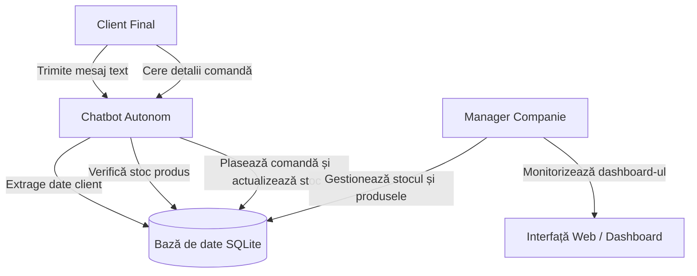

# Requirements Document - LanguageCRM

**Status:** În curs de revizuire / Schiță  
**Product Owner:** Pricop Alexandru 
**Echipa de Dezvoltare:** Baroană Alexandru-Cătălin, Jitescu Silviu-Cristian, Taraleșca Ovidiu, Coman Tudor

---

## 1. Descrierea problemei abordate
În mod tradițional, gestionarea relației cu clienții (CRM) și plasarea comenzilor presupun un efort manual intens din partea operatorilor umani ai unei companii, care trebuie să citească mesaje, să extragă date, să verifice stocurile și să introducă informațiile în sistem. Acest flux este lent, repetitiv și predispus la erori umane.

**Soluția propusă (LanguageCRM cu Agent Conversațional Autonom):** O platformă inteligentă centrată pe un **chatbot autonom în limbaj natural**. Chatbotul preia dialogul direct cu clienții finali, înțelege intențiile acestora (plasare de comenzi, interogare stocuri, detalii despre produse), verifică automat disponibilitatea în baza de date SQLite, înregistrează comenzile și actualizează stocurile fără a necesita intervenția manuală a operatorilor companiei.

---

## 2. Descrierea utilizatorilor și a principalelor categorii
Sistemul deservește trei categorii principale de utilizatori (inclusiv actori autonomi):

1. **Clientul Final (Customer):**
   * **Rol:** Interacționează prin intermediul chat-ului cu sistemul pentru a achiziționa produse sau a cere informații.
   * **Nevoi:** Comunicare naturală, rapidă, fără formulare stufoase și confirmare instantanee a comenzilor.
2. **Chatbotul Autonom (AI Agent / System):**
   * **Rol:** Analizează mesajele clienților, extrage entitățile (nume produs, cantitate, date client), interoghează stocul și operează automat baza de date.
3. **Managerul / Administratorul (Manager):**
   * **Rol:** Supraveghează sistemul global, vizualizează rapoartele din dashboard, administrează stocurile și intervine doar în cazul alertelor sau excepțiilor.

---

## 3. Product Goal (Obiectivul Produsului)
> „Dezvoltarea unui sistem CRM autonom bazat pe limbaj natural, în care un chatbot preia interacțiunea directă cu clienții și automatizează fluxul de plasare a comenzilor și verificare a stocurilor, reducând intervenția umană din partea companiei la zero pentru fluxul standard.”

---

## 4. Cerințe Funcționale și Nefuncționale

### 4.1. Cerințe Funcționale (Functional Requirements)
* **CF-01 (Chat Conversațional):** Sistemul trebuie să ofere o interfață web de tip chat prin care utilizatorii pot comunica în limbaj natural.
* **CF-02 (Extragerea entităților):** Backend-ul trebuie să proceseze textul primit și să identifice automat datele clientului și produsele dorite.
* **CF-03 (Gestionarea automată a clienților):** Sistemul înregistrează sau actualizează automat clienții noi în baza de date SQLite.
* **CF-04 (Verificarea automată a stocului):** Sistemul interoghează stocul disponibil înainte de validarea oricărei comenzi cerute prin chat.
* **CF-05 (Plasarea automată a comenzii):** Dacă stocul este suficient, comanda este plasată automat de chatbot, iar stocul se actualizează (scade).
* **CF-06 (Alertare stoc epuizat):** Managerul este notificat vizual în dashboard dacă un produs atinge un nivel critic sau zero în stoc.
* **CF-07 (Dashboard de vizualizare):** O pagină secundară afișează tabelele clasice cu clienți, comenzi și stocuri pentru monitorizarea generală.
* **CF-08 (Rapoarte stoc):** Managerul poate vizualiza rapoarte legate de datele relevante din baza de date a produselor, la fel si date sau metrici despre utilizatori.
* **CF-09 (Vizualizare produse):** Utilizatorul poate vizualiza produsele disponibile, la fel si vizibilitatea lor in functie de stoc.

### 4.2. Cerințe Nefuncționale (Non-Functional Requirements)
* **CNF-01 (Performanță):** Timpul de răspuns al chatbotului la o comandă text nu trebuie să depășească 2 secunde în mediul local Docker.
* **CNF-02 (Portabilitate):** Aplicația trebuie să ruleze identic pe orice sistem de operare folosind containere Docker și `docker-compose`.
* **CNF-03 (Securitate):** Datele sensibile și cheile API nu vor fi niciodată expuse sau urcate în repository-ul public (protejate prin `.gitignore`).
* **CNF-04 (Lizibilitate):** Aplicația trebuie să fie usor de vizualizat pentru utilizatori.

---

## 5. Use Case Diagram (Reprezentare UML / Mermaid)

Diagrama de mai jos ilustrează interacțiunile dintre actorii sistemului și principalele funcționalități:

---

## 6. Product Backlog – Set Inițial de 15 User Stories

Fiecare User Story respectă șablonul standard: **`AS A <USER>, I CAN <DO>, SO THAT <VALUE>`**.

### Modulul 1: Chatbot & Limbaj Natural (Natural Language Processing)
* **US-01:**
  * **Story:** *Ca si* client, *pot sa* scriu un mesaj liber în fereastra de chat, *astfel incat* pot comunica cu compania fără a naviga prin meniuri complexe.
* **US-02:**
  * **Story:** *Ca si* sistem (chatbot), *pot* parsa mesajul text primit de la client pentru a detecta intenția (ex: comandă, întrebare stoc), *astfel incat* pot rula logica de business corespunzătoare.
* **US-03:**
  * **Story:** *Ca si* client, *pot sa* primesc un răspuns instantaneu din partea chatbotului în cadrul aceleiași ferestre de chat, *astfel incat* am confirmarea interacțiunii în timp real.
* **US-04:**
  * **Story:** *Ca si* client, *pot sa* primesc o clarificare de la chatbot dacă mesajul meu este ambiguu sau lipsesc detalii (ex: cantitatea), *sothat* comanda să poată fi corect înțeleasă.

### Modulul 2: Gestiunea Clienților (Clients & CRM)
* **US-05:**
  * **Story:** *Ca si* sistem (chatbot), *pot* extrage automat datele de contact (nume, telefon, email) dintr-o conversație, *astfel incat* sa creez un profil nou de client în baza de date SQLite fără intervenție umană.
* **US-06:**
  * **Story:** *Ca si* sistem, *pot* verifica dacă un client există deja în baza de date după numărul de telefon sau nume, *astfel incat* sa nu duplic înregistrările.
* **US-07:**
  * **Story:** *Ca si* manager, *pot* vizualiza lista completă a clienților înregistrați automat de chatbot într-un tabel dedicat pe dashboard, *astfel incat* sa pot analiza baza de date a companiei.

### Modulul 3: Gestiunea Stocurilor & Inventar (Inventory)
* **US-08:**
  * **Story:** *Ca si* manager, *pot* adăuga produse noi și cantități inițiale în stoc prin intermediul interfeței backend/bazei de date, *astfel incat* chatbotul să aibă de unde scădea produsele.
* **US-09:**
  * **Story:** *Ca si* sistem, *pot* interoga automat stocul unui produs în momentul în care un client solicită o cantitate prin chat, *astfel incat* sa pot lua o decizie de validare.
* **US-10:**
  * **Story:** *Ca si* manager, *pot* vizualiza nivelul curent al stocurilor în timp real pe dashboard, *astfel incat* sa știu când este nevoie de reaprovizionare.

### Modulul 4: Automatizarea Comenzilor (Orders Automation)
* **US-11:**
  * **Story:** *Ca si* client, *pot* plasa o comandă completă doar tastând textul dorit în chat, *astfel incat* procesul de cumpărare să fie complet autonom și automatizat.
* **US-12:**
  * **Story:** *Ca si* sistem, *pot* valida automat comanda dacă produsul există în stocul cerut, actualizând (scăzând) stocul din baza de date SQLite, *astfel incat* inventarul să rămână corect.
* **US-13:**
  * **Story:** *Ca si* client, *pot sa* primesc un mesaj automat de refuz sau alternativă în chat dacă stocul este insuficient, *astfel incat* sa știu că produsul nu este momentan disponibil.
* **US-14:**
  * **Story:** *Ca si* manager, *pot* vedea istoricul tuturor comenzilor generate automat de chatbot într-un tabel centralizat, *astfel incat* sa pot urmări vânzările companiei.

### Modulul 5: Alerte & Administrare Excepții
* **US-15:**
  * **Story:** *Ca si* manager, *pot* vizualiza o alertă vizuală în dashboard atunci când stocul unui produs scade sub o limită critică, *astfel incat* sa pot interveni operativ.